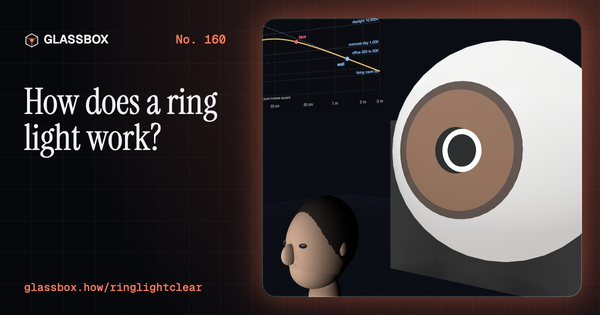
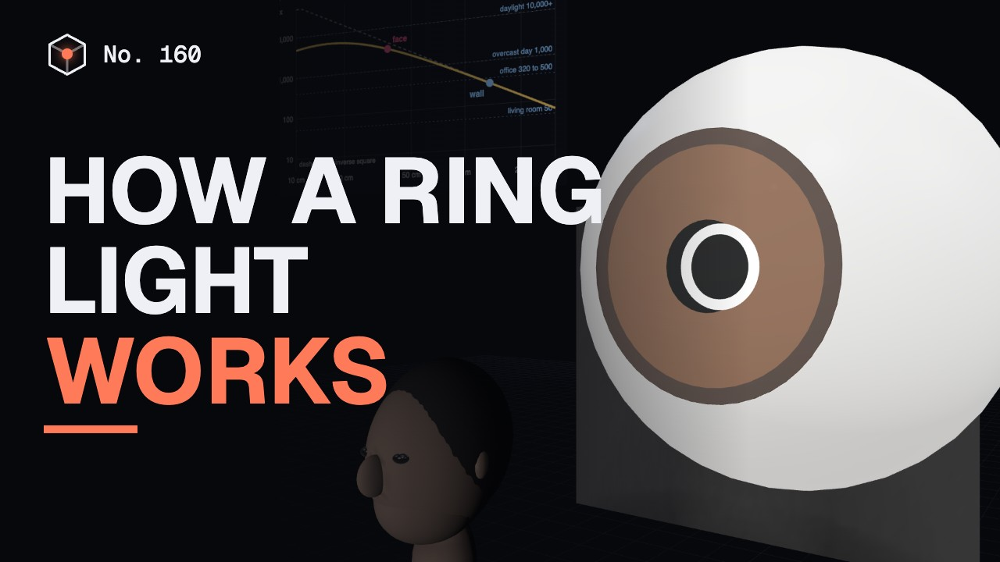
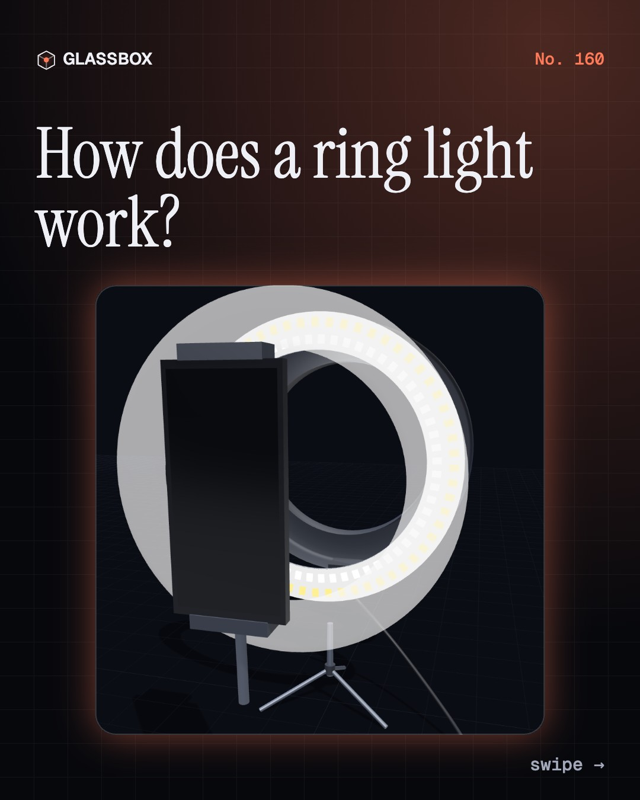
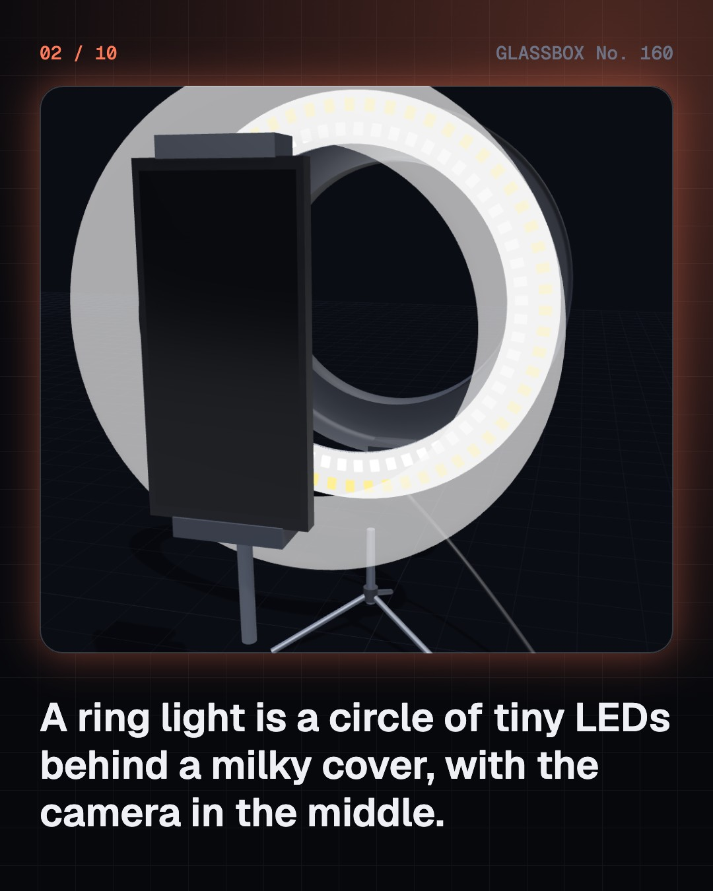
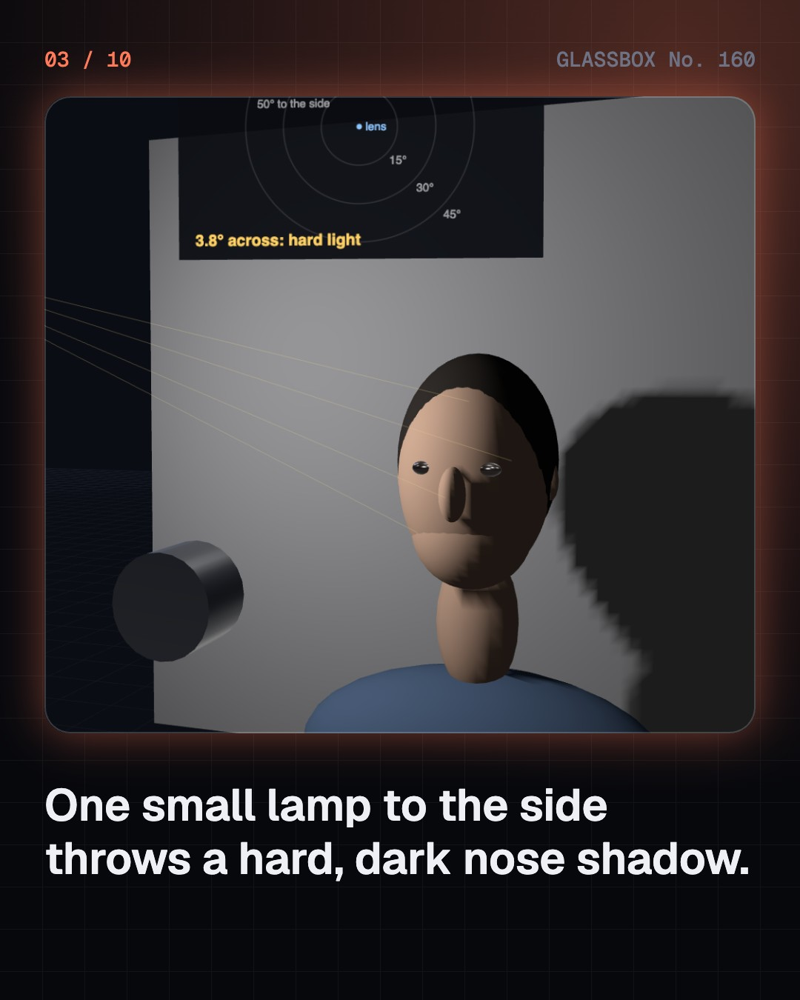
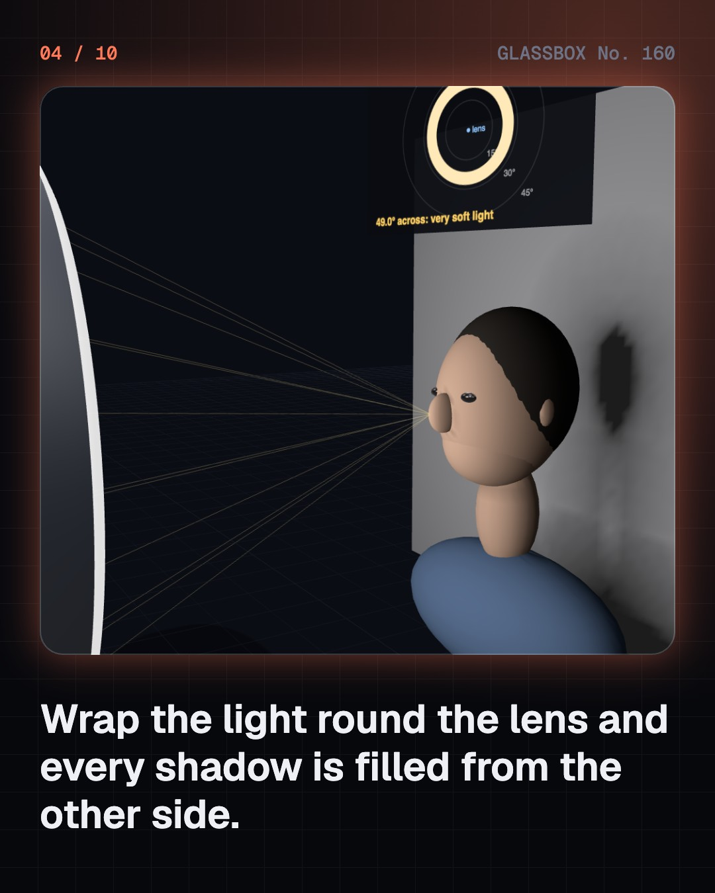

<!-- glassbox:start -->
<!-- Generated from glassbox.json by the Glassbox hub (npm run readme -- ringlightclear). Edit glassbox.json, not this block. -->
<p align="center"><a href="https://glassbox.how/e/ringlightclear/"></a></p>

<h1 align="center">RingLightClear</h1>

<p align="center"><b>How does a ring light work?</b><br>Why does a circle of tiny LEDs make a face look so smooth? Trace the shadows a ring fills in, find its reflection in an eye, mix warm and cool light, and watch a cheap dimmer paint dark bands across a phone video.</p>

<p align="center"><a href="https://glassbox.how/ringlightclear/"><b>▶ Play with it</b></a> &nbsp;·&nbsp; <a href="https://glassbox.how/e/ringlightclear/">Read the 60-second explainer</a> &nbsp;·&nbsp; <a href="https://glassbox.how/ringlightclear/glassbox/reel.mp4">Watch the 40-second video</a></p>

<p align="center">
  <a href="https://glassbox.how/e/ringlightclear/"></a>
  <a href="https://glassbox.how/e/ringlightclear/"></a>
  <a href="LICENSE"></a>
  <a href="LICENSE-CONTENT.md"></a>
  <a href="#privacy"></a>
</p>

## In 60 seconds

1. **A circle of LEDs.** A ring light is a flat ring-shaped board of a hundred or more tiny white LEDs, half warm and half cool, behind a milky diffuser, with the camera looking through the hole. A 26 cm USB ring draws at most 5 V × 2 A = 10 W and gives roughly 540 lumens.
2. **Why a ring fills shadows.** A small lamp to one side leaves a hard nose shadow. A ring sends light from every side of the lens, so skin hidden from one part of the ring is still lit by the rest. What matters is how big the source looks from the face: a 26 cm ring at 50 cm spans about 29°. The only shadow left is a thin halo on a wall close behind.
3. **The circle in the eye, and lux.** The cornea is a convex mirror with a focal length near 3.9 mm, so a 26 cm ring at 50 cm shows up as a circle about 2 mm wide. That ring puts roughly 600 lux on the face, like a well lit office. Twice as far gives about a quarter of the light, which is why the wall behind goes dark.
4. **Warm, cool and true.** Each white LED is a blue chip under yellow phosphor. Mixing the 3,000 K and 6,000 K sets gives any white in between, and the camera's white balance decides whether it looks neutral. Ordinary LEDs are short of deep red, so skin can look grey. High-CRI LEDs (95 and up, with a high R9) fill the reds back in.
5. **Dimming and dark bands.** Cheap dimmers blink the LEDs fully on and off (PWM). A phone's rolling shutter reads its sensor row by row, so short exposures catch the blinks as dark bands. A slower shutter, PWM at thousands of hertz, or steady-current dimming cures it. IEEE 1789 treats full on-off flicker as low risk only above about 1,250 Hz.
6. **Use it well.** Raise the ring a little and the glare slides off spectacle lenses. Do not stare into any bright lamp at close range, though official reviews (CIE 2019, SCHEER 2018) find no evidence of eye harm from white LEDs in normal use. In India, LED lights and adapters need BIS registration. The same on-axis trick lights teeth, microscopes and factory parts.

## Words worth knowing

| Term | Meaning |
|---|---|
| **Diffuser** | A milky cover that scatters the light of many small LEDs into one even glow. |
| **Penumbra** | The part-shadow at a shadow's edge, where some of the lamp is hidden and some still shines. |
| **Angular size** | How big a light source looks from the subject, as an angle. Bigger means softer shadows. |
| **Catchlight** | The reflection of a lamp in the eye. The cornea is a convex mirror, so a ring appears as a small circle. |
| **Lux** | Light landing on a surface: one lumen spread over one square metre. |
| **Colour temperature** | The colour of a white light in kelvin: about 3,000 K is warm, about 6,000 K is cool. |
| **CRI and R9** | Scores out of 100 for how truly a lamp shows colours. R9 tests a strong red, which matters for skin. |
| **PWM** | Pulse-width modulation: dimming by switching LEDs fully on and off very fast. |
| **Rolling shutter** | A camera sensor that records a frame row by row, so a blinking lamp can show as dark bands. |

## A short history

**Four centuries from Kepler's rule for fading light to a glowing circle on every creator's desk.**

- **1604** · Light thins out with the square of the distance (Johannes Kepler, Prague)
- **1952** · The ring flash, made for dentists (Lester A. Dine, New York)
- **1962** · The first practical visible LED (Nick Holonyak Jr., General Electric, Syracuse, New York)
- **1993** · A blue LED bright enough to use (Shuji Nakamura, Nichia, Tokushima)
- **1996** · Blue plus phosphor makes white (Nichia, Tokushima)
- **2014** · A Nobel Prize for the blue LED (Isamu Akasaki, Hiroshi Amano and Shuji Nakamura, Stockholm)
- **2015** · India buys LED bulbs by the crore (Government of India (UJALA), New Delhi)
- **2015** · Engineers set limits on flicker (IEEE, New York)

The full story, with 28 moments, charts, people and 35 sources: [glassbox.how/e/ringlightclear/history](https://glassbox.how/e/ringlightclear/history/). The data lives in [`history.json`](history.json).

## Video and slides

Made with the Glassbox studio from this box's storyboard (`window.glassbox.director`). Free to reuse under CC BY 4.0.

<a href="https://glassbox.how/ringlightclear/glassbox/video.mp4"></a>

<p><a href="glassbox/slide-1.jpg"></a> <a href="glassbox/slide-2.jpg"></a> <a href="glassbox/slide-3.jpg"></a> <a href="glassbox/slide-4.jpg"></a></p>

| File | What | Size |
|---|---|---|
| [`glassbox/reel.mp4`](https://glassbox.how/ringlightclear/glassbox/reel.mp4) | Reel / Short, with captions and soundtrack | 1080×1920 |
| [`glassbox/video.mp4`](https://glassbox.how/ringlightclear/glassbox/video.mp4) | YouTube video, with captions and soundtrack | 1920×1080 |
| `glassbox/slide-1…10.jpg` | Instagram carousel | 1080×1350 |
| `glassbox/thumb.jpg` | YouTube thumbnail | 1280×720 |
| `glassbox/cover.jpg` | Share card and repo social preview | 1200×630 |
| [`glassbox/history-reel.mp4`](https://glassbox.how/ringlightclear/glassbox/history-reel.mp4) | “History in 10 moments” Reel / Short | 1080×1920 |
| `glassbox/history-slide-*.jpg` | History carousel | 1080×1350 |
| `glassbox/post.json` | Post copy and schedule used by the publish kit | |

## Privacy

This box has no accounts and no ads, and it ships its own fonts and libraries. When you run it yourself it sends nothing anywhere. On glassbox.how, the site's `/bar.js` also loads Glassbox's analytics: **Google Analytics** to count visits (it asks first in the EU, UK and Switzerland, and stays off when your browser sends Global Privacy Control or Do Not Track) and **ClickTrust** to detect bots.

It remembers a few things **in your own browser only**, and never sends them anywhere:

| Browser storage key | What it holds |
|---|---|
| `ringlightclear.v1` | Which chapters you have opened, your best quiz scores, and sound on or off. |

Exactly what each one sees is at [glassbox.how/privacy](https://glassbox.how/privacy/).

## Licences

- **Code:** [MIT](LICENSE). Use it, change it, ship it.
- **Explanations, text, images and videos** (`glassbox.json`, `glassbox/`): [CC BY 4.0](LICENSE-CONTENT.md). Credit “Glassbox, glassbox.how/e/ringlightclear”.
- **Third-party parts** keep their own licences: [three.js](https://threejs.org) (MIT), [Geist, Instrument Serif](https://openfontlicense.org) (SIL OFL 1.1).
- The Glassbox name and logo aren't covered by either licence. See the [terms](https://glassbox.how/terms/).

Found a mistake? [Open an issue](https://github.com/bdeeps/ringlightclear/issues). Corrections happen in public.
<!-- glassbox:end -->

## Run it

It's plain HTML, CSS and JavaScript. No build step and no dependencies. Run locally, it contacts no other website.

```bash
python3 -m http.server 8000
```

Three.js and the fonts ship in `vendor/` and `fonts/`, so it also works offline.

Then open http://localhost:8000.

## How it's built

| File | What |
|---|---|
| `index.html`, `css/app.css` | The page and its styles |
| `js/app.js`, `js/stage.js`, `js/ui.js`, `js/kit.js` | The shared Glassbox 3D engine: chapters, 3D stage, controls, quiz, video director |
| `js/chapters/*.js` | One file per chapter: the 3D model, controls, text, key terms, quiz and video scenes |
| `js/ring.js` | Shared by the chapters: ring photometry, a small shadow ray tracer for the mannequin head and wall, LED spectra and colour temperature, PWM against rolling-shutter maths, mirror maths for eyes and spectacles, and the generic 3D models |
| `glassbox.json` | Title, question, explainer beats, key terms, browser storage and credits shown on glassbox.how |
| `reel` in each chapter | The storyboard the Glassbox studio records into short videos |
| `glassbox/` | The published video, slides, thumbnail and post copy |
| `fonts/`, `vendor/three/` | Self-hosted Geist and Instrument Serif (SIL OFL 1.1) and three.js (MIT) |
